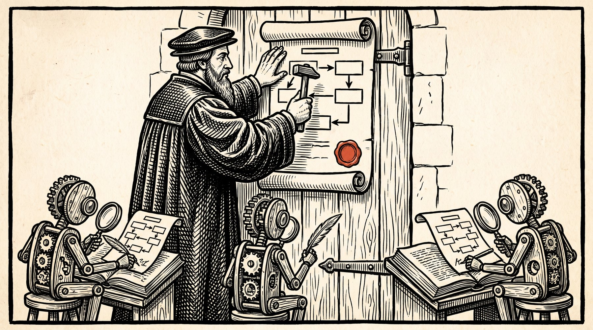
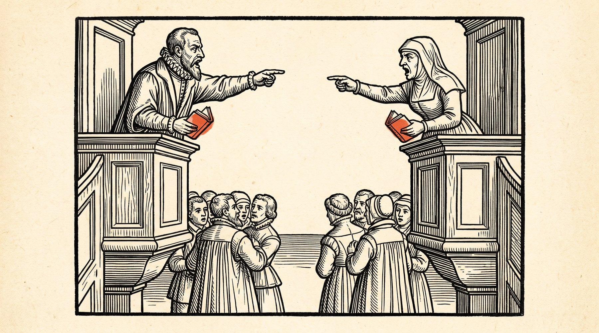
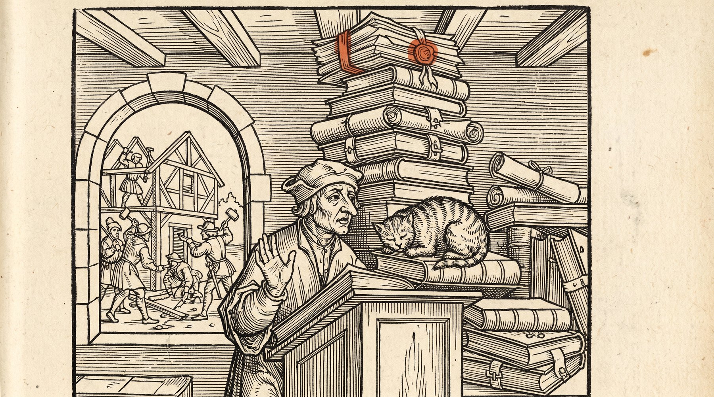
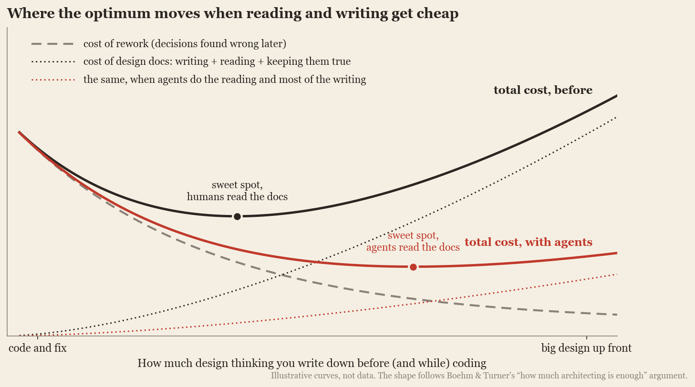
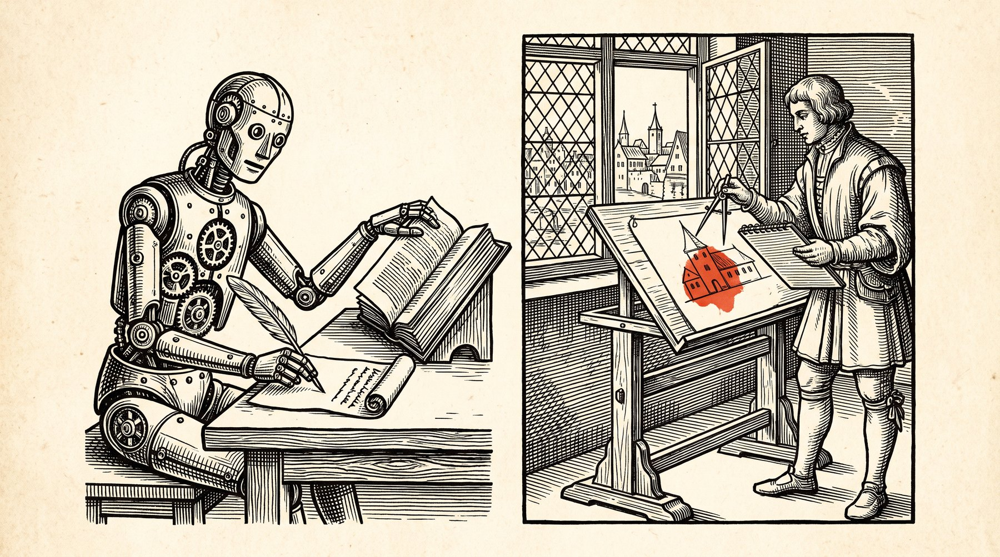

Agility reminds me of a religion that has one denomination per individual.

I have not once met, in my whole career, a developer who didn't agree with "agile". I have met some disconnected "software managers" (with little experience of how software projects actually go) who pushed for more process, for long months of writing specifications, and so on. But never an actual developer. No. We all believe in agility. But then we all disagree on how it should actually be carried out. More than once, Alice has complained to me that Bob's approach wasn't agile, not knowing that Bob had already come to me with the same complaint about Alice.

What gives?

Part of the answer is the word itself. Martin Fowler named the mechanism back in 2006: [semantic diffusion](https://martinfowler.com/bliki/SemanticDiffusion.html), where a term coined with "a pretty good definition" spreads faster than its meaning, until it means whatever the speaker needs. "'Agile' sounds like something you'd certainly want to be," he noted. Try finding a team that wants to be called clumsy.

In 2014 Dave Thomas, one of the Manifesto's seventeen signatories, wrote that "[the word 'agile' has been subverted to the point where it is effectively meaningless](https://pragdave.me/thoughts/active/2014-03-04-time-to-kill-agile.html)", and that forming an industry body around its four values "always struck me as creating a trade union for people who breathe." Ron Jeffries, another signatory, titled a 2018 piece [Developers Should Abandon "Agile"](https://ronjeffries.com/articles/018-01ff/abandon-1/).

The surveys back them up. In the [17th State of Agile report](https://www.businesswire.com/news/home/20240116199385/en/17th-State-of-Agile-Report), 71% of respondents said they use agile, only 11% of those said they were very satisfied with it, and 34% said they either build their own framework or follow none at all.

We do, at least, share a devil. Whatever our denomination, we can gather around the fire and agree on what we are against: **Waterfall**.[^1] Or, to give it the full litany, *Big Design Up Front* (BDUF, which is roughly the sound a requirements binder makes when it lands on your desk), its sibling *Big Requirements Up Front*, *plan-driven development*, *heavyweight methodology*, *document-driven development*, *phase-gate*, and the *V-Model*, which is Waterfall folded in half so it fits in the binder. You know the rite. Months of requirements gathering. Months of specification. A design phase whose deliverable is a document whose deliverable is a signature, after which the document is placed in a shared folder that no living person has opened twice, so that eighteen months later, when the thing ships late and wrong, there exists a signed artifact proving it was supposed to ship on time and right.

And then there's the hybrid that Forrester was already calling, in 2011, [Water-Scrum-Fall](https://www.forrester.com/report/water-scrum-fall-is-the-reality-of-agile-for-most-organizations-today/RES60109): Waterfall wearing a Scrum lanyard, two-week sprints sandwiched between a year of planning and a quarterly release.

. Redrawn from Royce (1970).")

So yes, we can all unite against the big bad wolf of process.

Can we?

In light of the AI revolution (which is still happening, in case you hadn't noticed), I think we should revisit even the absolute, universal truths. Including the great one, the one that even Alice and Bob agree on.

This is me doing that.

## What the bureaucrats got right

Let me make the devil's case for a moment.

Upfront design is where you explore the space before you commit to a path in it. A good design phase surfaces the tradeoffs while they are still cheap to argue about. Postgres or a document store? Three services, or will one do?

Google's internal design-doc practice, as [Malte Ubl describes it](https://www.industrialempathy.com/posts/design-docs-at-google/), exists for "early identification of design issues when making changes is still cheap", and for "scaling knowledge of senior engineers into the organization." Michael Nygard's [Architecture Decision Records](https://cognitect.com/blog/2011/11/15/documenting-architecture-decisions) start from the observation that "one of the hardest things to track during the life of a project is the motivation behind certain decisions," and that without it a newcomer can only choose between "blind acceptance or blind reversal."

With a design everyone has read, ten people can write code in parallel and their pieces still fit when they meet.

Say Alice stores timestamps in UTC and Bob stores them in local time. Both pull requests pass review. The bug shows up on the first Sunday the clocks change. Nobody ever wrote down which way this team does it, so each of them guessed, and both guessed reasonably.

Done well, upfront design also buys flexibility in the places that will need it. Even Fowler, the patron saint of evolutionary design, writes that "[in its common usage, evolutionary design is a disaster](https://martinfowler.com/articles/designDead.html)" and "I prefer planned design to 'code and fix'." His own definition of [YAGNI](https://martinfowler.com/bliki/Yagni.html) carries the exception most people skip: it "does not apply to effort to make the software easier to modify." *You aren't gonna need it* is good advice about features, and Fowler never meant it for seams, the places where you deliberately leave room to swap one implementation for another. Adding one early usually costs you a single parameter that defaults to what you'd have done anyway.

When Amazon engineers [applied formal specification to ten large systems](https://www.amazon.science/publications/how-amazon-web-services-uses-formal-methods), they found bugs "we are sure we would not have found by other means," including one with a 35-step error trace that "had passed unnoticed through extensive design reviews, code reviews, and testing."

What I will *not* use to make this case is the famous claim that a defect costs 100 times more to fix in production than in requirements. That chart has been reproduced in a thousand slide decks, and its provenance is thin. Hillel Wayne went looking for the IBM study it is usually pinned on and, [as The Register reported](https://www.theregister.com/2021/07/22/bugs_expense_bs/), found "one tiny problem with the IBM Systems Sciences Institute study: it doesn't exist." Laurent Bossavit's [The Leprechauns of Software Engineering](https://leanpub.com/leprechauns) traces the figure back to course notes and decades-old data.

The more defensible version is the boring one, from Barry Boehm and Richard Turner's [Balancing Agility and Discipline](https://www.informit.com/store/balancing-agility-and-discipline-a-guide-for-the-perplexed-9780132651806) and from Waterman, Noble and Allan's grounded theory of agile architecture, aptly titled [How Much Up-Front?](https://ieeexplore.ieee.org/document/7194587): the right amount of upfront design depends on how large, how critical and how volatile the system is. In other words, it depends. (Nobody ever got a keynote out of "it depends".)

## Why we threw it out anyway

For a long time, though, "it depends" mostly came out as "less". Design documents cost more than they returned.

First, the documents drifted. In the best-known study of how engineers use documentation, [Lethbridge, Singer and Forward](https://doi.org/10.1109/MS.2003.1241364) found that 68% agreed documentation "is always outdated relative to the current state of a software system."

No engineer would keep two copies of the same data and sync them by hand. We even named the rule, Single Source of Truth. Heavyweight process broke it across whole projects. The code was one copy of the truth and the spec was another, kept in sync by whoever remembered to.

The same study adds a nuance I like. Eighty-one percent also agreed that documentation "can be useful, even though it might not always be the most up-to-date." So a stale doc still has some use, as long as you check it against the code. And once you're reading the code anyway, most people skip the doc.

Second, nobody read them. I don't blame anyone. Reading a sixty-page document carefully, and keeping it in your head while you code, costs a lot of attention up front, and the payoff, if it ever comes, comes months later. At one company Lethbridge's team observed, engineers consulted documentation in 12 of 357 logged events: 3%. No wonder. By one estimate, just understanding the code already eats [about 58% of a developer's working time](https://doi.org/10.1109/TSE.2017.2734091).

Third, most attempts to keep documents true failed, because keeping them in sync was still a person's job. Model-driven engineering promised that the diagrams would *be* the code. In Marian Petre's [interviews with 50 professional developers](https://neverworkintheory.org/2013/06/13/uml-in-practice-2.html), 35 used no UML at all and none used it wholeheartedly; keeping models in sync with code was one of the reasons. The remedies that did survive (doctests, executable specifications, [architectural fitness functions](https://www.thoughtworks.com/radar/techniques/architectural-fitness-function), [ArchUnit](https://www.archunit.org/)) are all checked against the code automatically, every time it builds.

So the Agile Manifesto valued "[working software over comprehensive documentation](https://agilemanifesto.org/)". People forget the next line, "while there is value in the items on the right, we value the items on the left more", and forget that Jim Highsmith's [account of the Snowbird meeting](https://agilemanifesto.org/history.html) says "we embrace documentation, but not hundreds of pages of never-maintained and rarely-used tomes." At 2001 prices, I'd have signed it too.

If agile is a religion, the Manifesto was its Reformation, and I'm not the first to say so. Jeff Atwood called software development [a religion](https://blog.codinghorror.com/software-development-its-a-religion/) in 2006, and K. Thomas Ulland has already cast the Manifesto as Luther's theses in [The Agile Reformation](https://acceptancepod.com/the-agile-reformation-a-critical-look-at-the-manifesto/).

## My design docs

I have a confession. For most of my career I have been a closet heretic in the agile church. I wrote design docs. An inordinate number of them.

Not specifications. I never wanted to tell a developer what to type. More like a field guide: research on the options available, the tradeoffs between them, the data that backed one choice over another, and the places where option A would bite us if we took it. I wanted to give developers the lay of the land, so they could code with freedom, but with context.

It cost me dearly. Researching and writing those documents ate weeks I could have spent coding. And the developers, who were busy shipping, rarely had time to read them fully. Skimming, mostly. Which was fine. Until the moment that reliably came, months later, when the team ran into a problem that the design doc had explicitly predicted, in a section that began with "were we to take option A...". We had taken option A.

Imagine my frustration.

## What changed

Two things changed at the same time.

First, writing got cheap. The research I used to do by hand (surveying libraries, reading papers, comparing approaches, pulling numbers) is now something I direct. Agents do the legwork. This essay is a small example: its research notes were compiled by agents working in parallel.

But "cheap" comes with an asterisk. Deep-research agents still invent sources: one 2026 audit found that [3% to 13% of the URLs they cite](https://arxiv.org/abs/2604.03173) have no record of ever having existed. So my part is now mostly deciding what matters, and checking that it's true. My obsession with data-backed design used to cost me weeks. It costs me a lot less now, even counting the fact-checking.

. Public domain.")

Second, reading got cheap, and that's the bigger deal. Developers no longer have to read the design doc carefully, because they are no longer its only reader. They point their coding agent at the design docs and ADRs, along with their own conventions and prompts, and the agent reads all of it, every time.

The Reformation also needed two things. The press made scripture cheap to produce, and vernacular translation let ordinary people read it without a priest in between. Here the agent plays both parts. It helps write the doc, and then it reads the doc in full for each developer, in the language of the code it is about to write.

Do agents actually follow what they read? The best evidence so far says yes. In [the first rigorous study of AGENTS.md-style context files](https://arxiv.org/abs/2602.11988), a team at ETH Zurich found that "instructions in the context files are well followed by coding agents."

But context files did not generally improve success rates, and raised costs by over 20%. Files generated by an LLM slightly *lowered* success. Repository overviews, "although popular and recommended by model providers, are not helpful." What did help was information the agent could not recover from the repository on its own, such as non-standard practices.

That last finding describes my old design docs almost exactly. What an agent can't get from your code, however fast it reads, is *why*. Why you rejected option A, say, or which constraint lives only in someone's head. That's the "were we to take option A" paragraph.

Margaret-Anne Storey's name for what goes missing is [intent debt](https://arxiv.org/abs/2603.22106), "the absence of externalized rationale." A good ADR is mostly that material. The old binders had it too, somewhere around page forty, after the glossary. Duncan Davidson put it plainly: [coding agents love decision records](https://duncandavidson.com/agents-love-decisions), because records "help them understand the intent behind the code rather than having to infer it." And Simon Willison, describing what he calls [vibe engineering](https://simonwillison.net/2025/Oct/07/vibe-engineering/): "Write good documentation first and the model may be able to build the matching implementation from that input alone."

In my own work, the result is that implementations now land in the right architectural ballpark far more often than they used to. It's not perfect (agents make mistakes, and so do I). But these days I mostly find the gap between "what the design doc said" and "what got built" in code review. I used to find it in production.

Then again, I know what self-reports like mine are worth.

.")

In [METR's 2025 randomised trial](https://arxiv.org/abs/2507.09089), sixteen experienced open-source developers expected AI tools to make them 24% faster, believed afterwards that they had been 20% faster, and were in fact 19% *slower*. The tools have improved a lot since early 2025, and METR's own [2026 follow-up](https://metr.org/blog/2026-02-24-uplift-update/) is honest that its newer data is an "unreliable signal." But nothing in it suggests developers got any better at judging their own speed.

So, with the appropriate hedge: the improvement feels dramatic to me. I haven't measured it, and as far as I know nobody has measured it for ADRs specifically. The closest study, on what its authors call [constraint decay](https://arxiv.org/abs/2605.06445), is a warning: agents lose about 27 points of test pass rate as structural requirements pile up. If that holds up, it argues for short design docs.

In the first draft of this essay I wrote that design docs had become "quadratically cheaper": writing got cheaper by some factor, reading by roughly the same factor, so a doc that actually shapes the code got cheaper by its square. I still like the intuition, but I can't show you data for it, so treat it as an argument.

## The new equilibrium

For twenty-five years we were told to pick a point on a line, with rigor at one end and speed at the other. Waterfall sat at the rigor end, cowboy coding at the speed end, and every agile denomination was a different opinion about where the sweet spot was.

Agents move the sweet spot along that line, toward more design. Most of what made rigor expensive was grunt work (writing the documents, reading them, keeping the code faithful to them), which agents now do.

But there's a force pulling the other way. Agents also make *code* cheap to rewrite, which makes Winston Royce's 1970 advice to "do it twice" (and Fred Brooks's "plan to throw one away") affordable for the first time. Cheap rework pulls the optimum back toward less upfront design.

Which force wins depends on how expensive the decision is to undo. A function is cheap to redo. A data model with three years of production data in it is not, and neither is a public API with customers on it. Those are the ones I'd write down.

So the new equilibrium looks like short iterations, as before, each one steered by a small body of design knowledge (ADRs, design notes, the reasons) that agents actually read. DORA's 2025 report points the same way. It found that AI acts as "[an amplifier, magnifying an organization's existing strengths and weaknesses](https://dora.dev/research/2025/dora-report/)", and two of the seven capabilities in its [AI Capabilities Model](https://cloud.google.com/blog/products/ai-machine-learning/introducing-doras-inaugural-ai-capabilities-model) are working in small batches and AI-accessible internal data.

The tool vendors have noticed. GitHub's [Spec Kit](https://github.blog/2025-09-02-spec-driven-development-with-ai-get-started-with-a-new-open-source-toolkit/), Amazon's Kiro and Tessl all sell some version of "spec-driven development," and [AGENTS.md](https://www.linuxfoundation.org/press/linux-foundation-announces-the-formation-of-the-agentic-ai-foundation) is now a Linux Foundation project that more than 60,000 open-source projects have adopted.

The backlash has already arrived, too. François Zaninotto called it [The Waterfall Strikes Back](https://marmelab.com/blog/2025/11/12/spec-driven-development-waterfall-strikes-back.html). Birgitta Böckeler, after trying the tools, wrote: "[To be honest, I'd rather review code than all these markdown files](https://www.martinfowler.com/articles/exploring-gen-ai/sdd-3-tools.html)." One [hands-on trial of Spec Kit](https://blog.scottlogic.com/2025/11/26/putting-spec-kit-through-its-paces-radical-idea-or-reinvented-waterfall.html) produced 2,577 lines of markdown for 689 lines of code.

First caveat: the Single Source of Truth problem does not vanish. An ADR that disagrees with the code is still a liability, and agents follow instructions faithfully, including stale ones. The difference is that an agent can now check ADRs against the code on every pull request, which nobody was ever going to do by hand.

A [2026 study of ADR violations](https://arxiv.org/abs/2602.07609) found LLMs good at spotting violations of decisions that are visible in code, and poor at spotting implicit or deployment-level ones. So write decisions that can be checked, and have them checked, the way doctests and fitness functions taught us.

Second caveat: the volume of documents can now outgrow anyone's ability to judge them. Take that Spec Kit trial and its 2,577 lines of markdown. I'd be surprised if anyone, human or agent, gave most of those lines much thought, and a document nobody thought about is the old binder again.

That matches the ETH study, where generated context files slightly hurt. Somebody still has to decide which lines matter, and that part I haven't managed to hand off.

## Machines doing machine work

Looking back, I think bureaucratic software process failed because it asked humans to act like machines. Read all sixty pages, and remember, eight months later, the constraint on page forty, when you're writing the code it constrains. Apply rule 7.3.2(b) as carefully on a Friday afternoon as on a Monday morning. We are not good at this. So we rebelled (rightly, I think) and called the rebellion agility.

Agents, on the other hand, will happily read page forty every single time. So give them the bureaucratic half of the job, and move up the abstraction ladder yourself, toward what I'd call *ideas engineering*. That means deciding what should exist and why, and writing it down well enough that a tireless reader can act on it.

The bureaucrats promised us code that matched its design, and never delivered, because they were trying to do it with people. We can keep our agility and, maybe, finally get that too.

Before anyone gets too triumphant, remember how the real Reformation went. It multiplied the arguments. Once everyone could read the text for themselves, everyone had their own reading, and the denominations bloomed. One per individual, you might say.

So Alice and Bob will go on disagreeing about what agile means, and each will bring an agent with its own instructions and its own way of reading. But for the first time, both agents will have read the same document. All of it. Which is more than Alice or Bob ever did.

[^1]: Waterfall's origin story is the best part. The 1970 paper every textbook cites as Waterfall's birth certificate, Winston Royce's [Managing the Development of Large Software Systems](https://web.archive.org/web/2016id_/http://www.cs.umd.edu/class/spring2003/cmsc838p/Process/waterfall.pdf), draws the famous cascade and then says, on the very next page, "I believe in this concept, but the implementation described above is risky and invites failure." He never uses the word "waterfall"; that arrived six years later, in [a paper by Bell and Thayer](https://archive.org/details/software_requirements_are_they_really_a_problem) that used it as a neutral description, not an insult. And Royce's cure for the risk was more process. "Do it twice," involve the customer, and, on how much documentation, "my own view is 'quite a lot'." He called "ruthless enforcement of documentation requirements" the first rule of managing software development. The single-pass version people actually ran was enshrined in 1985 by a US defense procurement standard, DoD-STD-2167, whose principal author, according to [Craig Larman and Victor Basili's history of iterative development](https://www.craiglarman.com/wiki/downloads/misc/history-of-iterative-larman-and-basili-ieee-computer.pdf), later regretted it: at the time, he "had not heard of iterative development." Almost nobody, it seems, read past the first diagram.
