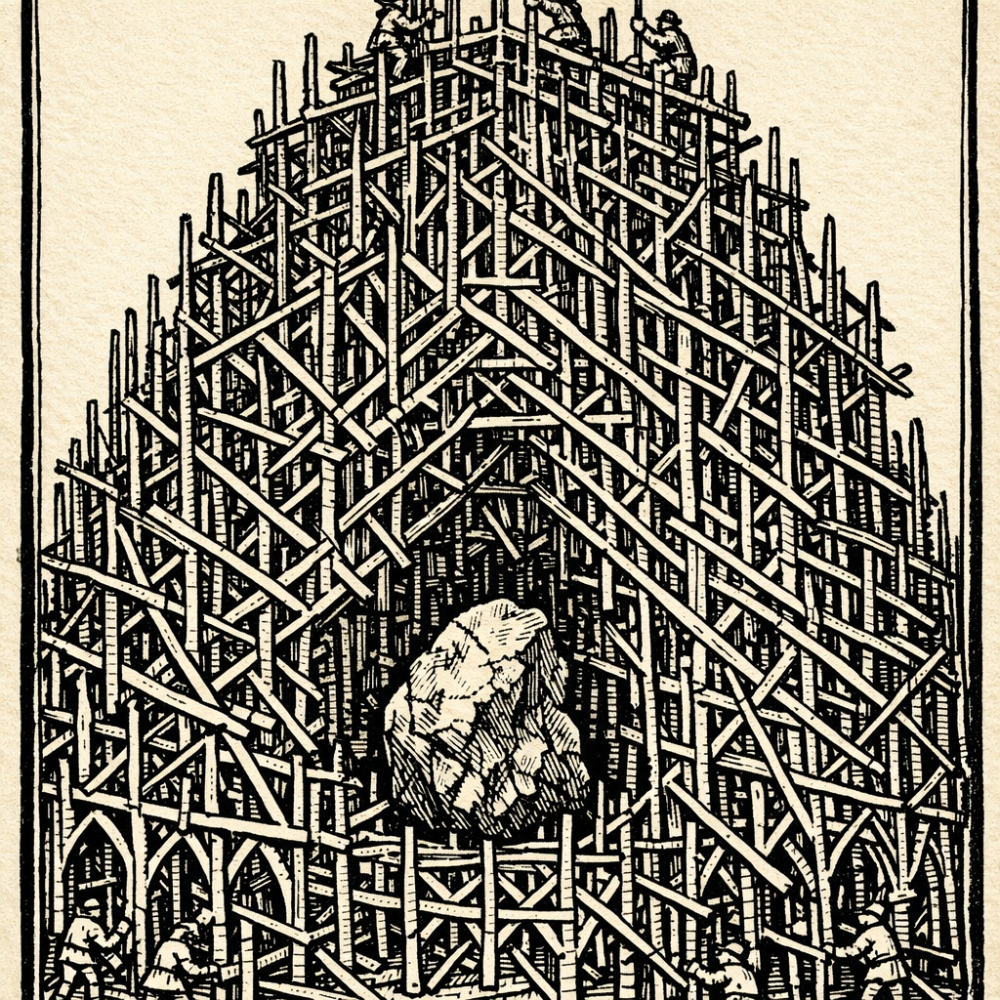
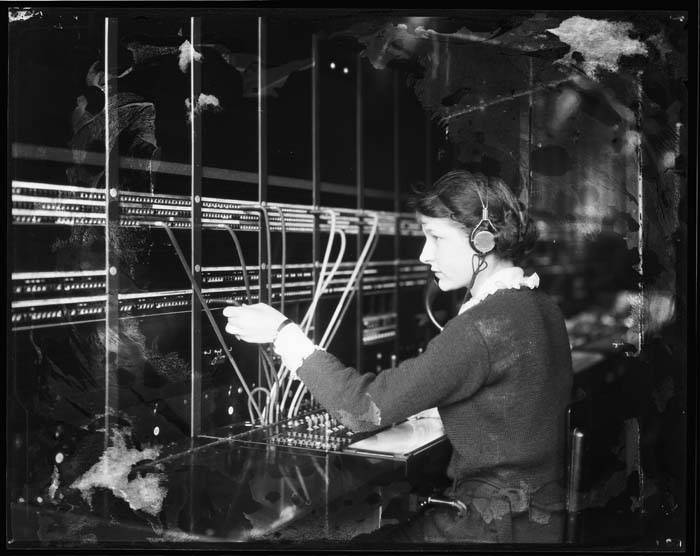
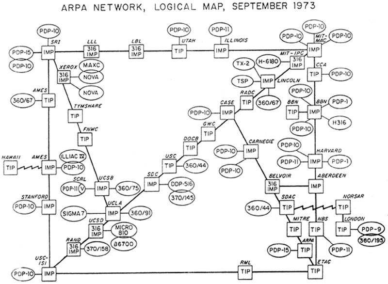

# AI and the Accretion Trap

In February 1995, an astronomer named Clifford Stoll [explained to the readers of Newsweek](https://www.newsweek.com/clifford-stoll-why-web-wont-be-nirvana-185306) why this internet thing wasn't going to work out.

He wasn't some random pundit. Stoll had chased a KGB-funded hacker through the ARPANET and written a bestseller about it. He knew the network better than almost anyone writing for a general audience. And he wrote this:

> "What the Internet hucksters won't tell you is that the Internet is one big ocean of unedited data, without any pretense of completeness. Lacking editors, reviewers or critics, the Internet has become a wasteland of unfiltered data. You don't know what to ignore and what's worth reading."

A few paragraphs later came the line that made the piece immortal:

> "We're promised instant catalog shopping—just point and click for great deals. We'll order airline tickets over the network, make restaurant reservations and negotiate sales contracts. Stores will become obsolete. So how come my local mall does more business in an afternoon than the entire Internet handles in a month?"

Here's the thing. **Every fact in that column was true.**

The internet of February 1995 *was* an ocean of unedited data. There *was* no trustworthy way to send money over it. His local mall *did* do more business in an afternoon. Audit Stoll's claims one by one and he passes.

Fifteen years later, when the column resurfaced to general hilarity, Stoll [showed up in the comments](https://web.archive.org/web/20100301081043/http://www.boingboing.net/2010/02/26/curmudgeony-essay-on.html). "Of my many mistakes, flubs, and howlers, few have been as public as my 1995 howler. Wrong? Yep." And then, which I find rather lovely: "Now, whenever I think I know what's happening, I temper my thoughts: Might be wrong, Cliff..."

What gives? How does a man get every fact right and the conclusion so wrong that it becomes a genre?

## "Are you trying to tell us that you open the switch up in the middle of the conversation?"

Thirty years before Stoll, Paul Baran had the same experience from the other side.

Baran was at RAND, designing a communications network that could survive a nuclear strike. His idea was to chop messages into blocks, let each block find its own way through a mesh of cheap, unreliable nodes, and put them back together at the far end. We call this packet switching now. In 1964 it had no name, and the people who knew the most about communications in the world, the engineers of AT&T's Long Lines division, thought it was nonsense.

Baran [told the story](https://www.wired.com/2001/03/baran/) in 2001. The Air Force wanted AT&T to build it: "'Look, we'll give you the money. Just do it.' AT&T replied, 'It's not going to work. And furthermore, we're not going into competition with ourselves.'" He went to Long Lines headquarters to explain, and one of the old analog hands stopped him: "Wait a minute, son. Are you trying to tell us that you open the switch up in the middle of the conversation?"

Yes. That was exactly what he was telling them.

The historian Janet Abbate, in [*Inventing the Internet*](https://mitpress.mit.edu/9780262511155/inventing-the-internet/), is kinder to the AT&T engineers than Baran was, and more precise about what they got wrong. They "tended to be familiar only with analog technology, and they doubted Baran's claims that an all-digital system could transcend the well-known limits on the number of links per call." Their whole engineering culture, she writes, "tried to increase the reliability of the phone system as a whole by making each component as reliable as possible." Baran "chose instead to make do with lower-quality communications links and to provide redundant components to compensate for failures."

. Redrawn by Wikimedia Commons user 1983, CC BY-SA 3.0.")

Read that last sentence again. It's the whole essay.

One tradition makes the thing reliable. The other makes the thing cheap and builds reliability *around* it. Baran put it as a boast: "You can get any reliability you want—far, far greater than the reliability of the components."

The AT&T engineers weren't stupid. They were experts. They looked at the naked primitive, a packet that might get dropped, might arrive out of order, might take a route nobody planned, and they compared it with a mature system that guaranteed your call would hold for as long as you kept talking. By that comparison the packet lost.

By that comparison the packet always loses. The comparison is the mistake.

## It kept happening

Once you see the shape you see it all over the history of the web, and the people making the mistake are never the ignorant ones.

**HTTP.** The protocol that carries the web forgets who you are between one click and the next. To the architects of the distributed-object systems of the early 1990s, with their persistent connections and two-phase commits, this was obviously disqualifying. Orfali and Harkey, who wrote the standard client/server textbooks, said so in 1998: "HTTP with CGI is a slow, cumbersome, and stateless protocol; it is not suitable for writing modern client/server applications." Jeffrey Mogul, who co-wrote the HTTP/1.1 spec, [gave a talk](https://static.usenix.org/events/usenix99/invited_talks/mogul.pdf) at USENIX in 1999 titled "What's wrong with HTTP (and why it doesn't matter)." His slides say, in order: "The HTTP protocol design is a mess." Then: "The bugs in HTTP don't matter because: It works well enough; It's not the only game in town; Revising it again would be too hard."

The forgetfulness turned out to be the point. A server that remembers nothing can be swapped for any other server, which is how you serve a billion people out of a warehouse of identical boxes. The missing memory got bolted on from the outside, as a cookie in your browser.

And here's a detail the usual telling leaves out. Roy Fielding, whose dissertation defined REST and made HTTP's statelessness respectable, [wrote](https://ics.uci.edu/~fielding/pubs/dissertation/evaluation.htm) that cookies are "an inappropriate extension," that they "violate REST," and that "cookie-based applications on the Web will never be reliable." He was right. The entire commercial web runs on them anyway. Hold on to that one; the scaffolding isn't always something the architect would approve of.

**The directory.** Yahoo hired people, whom it actually called "surfers," to read the web and file it into categories, the way a library files books. This was the responsible thing to do with an ocean of unedited data. Then two graduate students noticed that the mess of links *was* the editorial judgment, if you counted it right, and the directory was dead within a few years.

Clay Shirky [named the mechanism](https://shirky.com/essays/ontology-is-overrated-categories-links-and-tags/) in 2005: "The Web has an editor, it's everybody. In a world where publishing is expensive, the act of publishing is also a statement of quality—the filter comes before the publication. In a world where publishing is cheap, putting something out there says nothing about its quality. It's what happens after it gets published that matters." Stoll's complaint had been that there were no editors. There were. They just worked after the fact.

**JavaScript.** Brendan Eich prototyped it in ten days in May 1995, a scripting toy to sit next to the real language, which was going to be Java. Fielding again, [writing in 2000](https://ics.uci.edu/~fielding/pubs/dissertation/evaluation.htm), asks why the toy won: "It certainly isn't because of its technical quality as a language, since both its syntax and execution environment are considered poor when compared to Java." It won because it was already in every browser and ran without anyone installing anything.

Then came the scaffolding. Google hired Lars Bak in 2006 to build a real compiler for it; V8 shipped in 2008. In 2012 Microsoft put a type system on top. By 2025 the language with the most contributors on GitHub was [TypeScript](https://visualstudiomagazine.com/articles/2025/10/31/typescript-tops-github-octoverse-as-ai-era-reshapes-language-choices.aspx). The toy ate the industry. Then the grown-ups came, added the typing discipline they'd said it lacked, and kept the toy.

And the network itself. In December 1995, Bob Metcalfe, who invented Ethernet, [predicted in InfoWorld](https://quoteinvestigator.com/2020/03/09/collapse/) that the internet "will soon go spectacularly supernova and in 1996 catastrophically collapse." In 1997 he put the column in a blender and ate it on stage.

## The accretion trap

Let me name the pattern. As far as I can tell nobody has, and a thing with a name is easier to argue with.

A new primitive arrives broken. Not slightly broken: broken in exactly the ways an expert in the incumbent system is trained to notice. Packets get lost. The protocol forgets you. The data has no editor. The language has no types. The model makes things up.

The experts say so. They're right.

Then, if the primitive is cheap enough and spreads fast enough, people start building around it. Not fixing it. Building *around* it. Congestion control around lossy packets, cookies around a forgetful protocol, PageRank around an unedited web, a compiler and a type system around a ten-day language. Each layer compensates for one of the flaws the experts named. The layers accrete. And at some point the broken primitive, wearing its accreted layers, is the universal substrate, and the mature system it was compared against is a specialist subsystem humming somewhere in a basement.

The **accretion trap** is judging the primitive naked. It's a trap for experts specifically. Only an expert has a mature system to compare against, and the comparison is so obviously correct that it doesn't occur to you to ask what the primitive makes cheap, and whether cheapness will pay for its own repairs.

Bill Gates, of all people, saw it from inside an incumbent. In his "Internet Tidal Wave" [memo](https://www.wired.com/2010/05/0526bill-gates-internet-memo/) of May 1995 he wrote: "The PC wasn't perfect. Aspects of the PC were arbitrary or even poor. However a phenomena grew up around the IBM PC that made it a key element of everything that would happen for the next 15 years. Companies that tried to fight the PC standard often had good reasons for doing so but they failed because the phenomena overcame any weaknesses that resisters identified."

"Good reasons." He grants them the good reasons. That's the whole trap in two words.

I'm not the first to notice any of this. Richard Gabriel called it ["worse is better"](https://www.dreamsongs.com/RiseOfWorseIsBetter.html) in 1989, writing about why Unix and C beat Lisp, then spent a decade arguing with himself about it under a pseudonym; his final verdict is "I still can't decide." Clayton Christensen built a career on disruptive technologies that are worse on every metric the incumbent measures. Chris Dixon wrote in 2010 that ["the next big thing will start out looking like a toy."](https://cdixon.org/2010/01/03/the-next-big-thing-will-start-out-looking-like-a-toy/) What I'm adding is a name for the specific mistake the expert makes, so we can check whether we're making it right now.

Because we're having this argument again. And this time I'm one of the experts.

## Now do it for the model

A large language model, naked, is a machine for guessing the next word. Emily Bender and her co-authors said so in 2021, in the paper that gave the skeptics their mascot: "an LM is a system for haphazardly stitching together sequences of linguistic forms it has observed in its vast training data, according to probabilistic information about how they combine, but without any reference to meaning: a stochastic parrot."[^1]

Yann LeCun, who helped invent the field, put up a slide at NYU in March 2023 that is the AT&T engineer's eyeroll rendered as a formula. "Auto-Regressive LLMs are doomed," it said. If each token has some probability *e* of wandering outside the set of correct answers, then an answer of *n* tokens is correct with probability (1−*e*)^*n*. "This diverges exponentially. It's not fixable."

The math is right. It's right in exactly the way the AT&T engineers were right about links per call. It assumes each token's error is independent, and that nothing ever checks the output. Drop the second assumption, let a compiler or a test suite or a second model look at the answer, and the exponential stops diverging. This rebuttal was made [within a month](https://www.greaterwrong.com/posts/zyPaqXgFzqHkQfccq/contra-lecun-on-autoregressive-llms-are-doomed) of the slide, and it isn't clever. It's Baran's "far greater than the reliability of the components" with new nouns.

What's interesting is watching the people who build with these things change their minds, and listening to *what* changed them.

David Heinemeier Hansson built Rails and has never been accused of excessive enthusiasm for other people's tools. He spent 2025 as a skeptic. On [Lex Fridman's podcast](https://lexfridman.com/dhh-david-heinemeier-hansson-transcript) that summer he said of vibe coding, "if you can just vibe code it, you're not a programmer," and of the models as pair programmers, "if you were my junior programmer I'd start tapping my fingers and going like, you've got to shape up." A year later he was [back](https://lexfridman.com/dhh-2-transcript), having shipped a release of his Linux distribution without writing any of its code by hand. What changed? Not, by his own account, how smart the model was: "I don't know if Opus 4.5 was that much smarter than Opus 4 … but its ability to instrument your computer, to use tools, to check its own work, to apply its intelligence in such a way that you could get real meaningful work out of it, was completely different."

Instrument. Use tools. Check its own work. He's describing the scaffolding, not the primitive. The parrot didn't stop being a parrot. It got a compiler.

Simon Willison [made the same point](https://simonwillison.net/2025/Mar/2/hallucinations-in-code/) about the thing everyone's most afraid of: "Hallucinations in code are the least harmful hallucinations you can encounter from a model," because the code either runs or it doesn't, and "proving to yourself that the code works is your job." The flaw that disqualifies the naked primitive is the flaw the first layer of scaffolding catches for free.

And here's where it gets interesting. The skeptics have noticed the scaffolding too, and they want it back.

Gary Marcus, who's been predicting the wall since 2022, [wrote in July 2025](https://garymarcus.substack.com/p/how-o3-and-grok-4-accidentally-vindicated) that the systems "that draw on code interpreter, and hence by definition are neurosymbolic, often outperform those that lack symbolic tools." Translation: the harness is the formalists' idea, and the fact that the model only works inside one proves the formalists were right. When Apple's researchers published ["The Illusion of Thinking"](https://arxiv.org/abs/2506.06941) in June 2025, showing reasoning models collapsing on Tower of Hanoi past a certain size, the [rebuttal](https://arxiv.org/abs/2506.09250) was: ask the model to write a program that solves Hanoi instead of listing the moves, and it succeeds. Marcus read the same result as proof that "LLMs are no substitute for good well-specified conventional algorithms."

Notice the shape. Both sides agree on what happened: the model alone fails, the model plus a program succeeds. They disagree about who gets the credit. I think the honest answer, the one the history supports, is both. Both traditions won their layer last time too.

## Where this proves too much

If I stopped here I'd have written the essay the AI boosters want, and I'd deserve the comment thread Stoll got. So let me do the thing Stoll didn't do in 1995 and argue against myself.

**The cases are picked from the winners.** Of course the examples where the experts were wrong are the memorable ones. They became the internet. Now line up the hyped primitives where the experts said "that won't work" and were simply right. The Segway: projected 100,000 sales in its first year, about 140,000 in its entire life. 3D television. Second Life. The Semantic Web. NFTs. The Metaverse, where Meta's Reality Labs has so far lost roughly $84 billion against $12 billion in revenue. The forecasting literature, for what it's worth, finds no evidence that experts systematically underestimate anything. [Fye and colleagues](https://doi.org/10.1016/j.techfore.2012.10.026) looked at over two thousand technology forecasts and found the errors ran about equally in both directions. Something like one in five technologies that enter the hype machine ever come out the other side into ordinary use. And Chris Dixon's toy heuristic, the one that would have caught JavaScript, is the one its author later applied to web3. A pattern that matches both JavaScript and NFTs isn't a pattern. It's a mood.

**Accretion has failed before, in AI itself.** The expert-systems boom of the 1980s was an accretion strategy around a primitive, rule-based inference: knowledge engineers, inference shells, dedicated Lisp machines. The scaffolding was real and expensive and it didn't save the primitive. It collapsed around 1987 and the field spent a decade in a winter. Scaffolding isn't a guarantee. It's a bet that the primitive's cheapness will outrun the cost of the layers.

**The layers cost something, and this time someone's sending a bill.** The web's scaffolding was RFCs and open-source servers; its marginal cost was close to nothing. The LLM's scaffolding runs on a primitive that's metered by the token. OpenAI's o3 scored 87.5% on the ARC-AGI puzzles at roughly $4,560 per task. And the best controlled study we have of the thing everyone says is obvious, METR's [randomised trial](https://metr.org/blog/2025-07-10-early-2025-ai-experienced-os-dev-study/) of experienced developers in July 2025, found that AI tools made them 19% *slower*, while they believed afterwards they'd been about 20% faster. METR's [2026 follow-up](https://metr.org/blog/2026-02-24-uplift-update/) leaned the other way but called its own evidence "very weak," partly because the developers would no longer agree to work without the tools.

Sit with that. Scaffolding that feels productive isn't evidence that it is. The people inside the harness are the last ones who can tell.

**Some flaws might be structural, not transitional.** The web had SQL injection and fixed it, structurally, with parameterised queries: a wall between instructions and data. A model reads instructions and data as the same stream of tokens, and Willison's ["lethal trifecta"](https://simonwillison.net/2025/Jun/16/the-lethal-trifecta/) (private data, untrusted input, and the ability to send a message) has no parameterised query yet. Maybe one comes. Maybe this is the flaw that stays. The accretion trap says experts underestimate what layers can fix. It doesn't say layers fix everything, and anyone who tells you otherwise is selling something at $4,560 a task.

**And "the primitive wins" is not the same claim as "the valuations are justified."** The dot-com crash destroyed a great deal of money and not one packet. If the AI capital expenditure of the last two years turns out to be a bubble, and the people arguing that it is have [numbers](https://simonwillison.net/tags/paul-kedrosky/), it'll be perfectly consistent with everything in this essay. Stoll was wrong about the internet and would've been right to short Pets.com.

There's also a second meaning of the title that I didn't intend when I wrote it down and now can't un-see. Accreted layers become load-bearing. NAT boxes, bolted on to stretch IPv4 addresses, broke the end-to-end principle so thoroughly that for twenty years it was nearly impossible to deploy a new transport protocol; QUIC encrypts almost its entire header partly to escape them. DHH, in the same conversation where he recanted, says the stacked agent pull requests on his large codebases drift into "the classic ball of mud." The scaffolding that saves the primitive is also the scaffolding you can never take down. That's an accretion trap too, and it's the one the builders fall into rather than the skeptics.

## The formalists won their layer

So I want to be careful about who the villains are. The history doesn't have any.

The pragmatist primitive won distribution: it was everywhere, cheap, first. The formalist tradition won the guarantees layered on top. When the young internet suffered congestion collapse in October 1986 (throughput between two buildings 400 yards apart at Berkeley fell from 32 kilobits a second to 40 bits a second), it wasn't saved by more pragmatism. It was saved by Van Jacobson and Michael Karels sitting down and doing [careful control engineering](https://www.cs.princeton.edu/courses/archive/fall17/cos561/papers/TCP88.pdf). Amazon's engineers [used TLA+](https://cacm.acm.org/magazines/2015/4/184701-how-amazon-web-services-uses-formal-methods/fulltext), a formal specification language, to find bugs in S3 and DynamoDB that no amount of testing had caught. Google, having led the world away from database transactions, [brought them back](https://www.usenix.org/conference/osdi12/technical-sessions/presentation/corbett) with Spanner. And the type system that JavaScript "lacked" is now the most-used language on GitHub, and GitHub says part of the reason is that typed code works better with coding agents. The formalists' tool became scaffolding for the stochastic parrot.

The LLM world is converging on the same division of labour and has started giving it names: "compound AI systems," "LLM-Modulo" frameworks where the model proposes and a verifier disposes, and, in OpenAI's phrase from this year, "harness engineering." Probabilistic core, deterministic harness. The engineer who says "it hallucinates" is right. The engineer who builds the harness that catches the hallucination is also right. They're often the same person on different days of the week.

## A test, not a side

What I want from all this isn't a side. The sides are boring and both of them have a newsletter. What I want is a way to tell, standing in 1995 or in 2026, whether the expert in front of me is making the AT&T mistake or the Segway call. Here's my attempt. When someone who knows the incumbent system says a new primitive is broken, ask three questions.

**Is it already everywhere, and nearly free to try?** IP, HTTP and JavaScript were all shipping by default to millions before the critiques landed. The Segway wasn't. This is the condition the winners share and the losers mostly lack, and language models pass it. In Stack Overflow's [2025 survey](https://survey.stackoverflow.co/2025/ai), 84% of developers were using or planning to use them, and 46% distrusted what they produced. Both numbers at once. That's what adoption momentum looks like from the inside.

**Is the flaw the kind a layer can catch?** A dropped packet can be re-sent. A wrong line of code fails a test. A hallucinated citation fails a lookup. Those are flaws with a checker, and flaws with a checker get scaffolded. A flaw with no checker (instructions and data in one stream, say) might be the one that stays. Experts are good at naming flaws. The useful question is which kind.

**Who pays for the layers, and are they open?** The web's scaffolding was free and public, and the one protocol that tried to charge for itself, Gopher, died of it. The LLM's glue is going the open way (MCP and AGENTS.md [went to the Linux Foundation](https://www.linuxfoundation.org/press/linux-foundation-announces-the-formation-of-the-agentic-ai-foundation) in December 2025); the primitive underneath is metered. A substrate whose every call is billed is a different kind of substrate, and nobody knows yet what that does to the pattern.

Then write down what the expert said, with the date, and check back in ten years. Stoll did. "Might be wrong, Cliff..." is the most useful sentence in the whole debate, and it took him fifteen years to write it.

We could save some time.

[^1]: Bender, Gebru, McMillan-Major and Shmitchell, ["On the Dangers of Stochastic Parrots"](https://dl.acm.org/doi/10.1145/3442188.3445922), FAccT 2021, pp. 616–617. The sentence begins "Contrary to how it may seem when we observe its output," which is worth keeping in mind: their complaint is about the gap between how the output looks and what produced it, which isn't far from the point of this essay.
